<div align="center">



<a href="https://git.io/typing-svg"></a>

<br/>

[](https://resume.mohitcloud.com/)
[](https://x.com/Caz_PG)
[](https://github.com/MohitGupta12)


</div>

<br/>

## `> about`

```yaml
name:      Mohit
role:      B.Tech graduate, cloud and DevOps focused
now:       Cloud, DevOps and CI/CD workflows
before:    Full-stack web (MERN) and Android (Flutter, Firebase)
exploring: Web3, browser extensions, IoT, networks, ML
offline:   TFT, chess, anime
```

I like building things end to end: write the app, containerise it, wire the pipeline, ship it. Right now the interesting half of that sentence is everything after "write the app".

<br/>

## `> stack`

<div align="center">

**Cloud and DevOps**


**Web**


**Mobile and languages**


</div>

<br/>

## `> featured work`

<table>
  <tr>
    <td width="50%" valign="top">
      <h3><a href="https://github.com/MohitGupta12/DSA-Navigator">DSA Navigator</a></h3>
      A navigator for working through data structures and algorithms, built with Vite and Tailwind, live on Vercel.<br/><br/>
      
      <a href="https://dsa-navigator.vercel.app"></a>
    </td>
    <td width="50%" valign="top">
      <h3><a href="https://github.com/MohitGupta12/K8s">K8s</a></h3>
      CKA exam prep, Kubernetes fundamentals and helper scripts.<br/><br/>
      
    </td>
  </tr>
  <tr>
    <td width="50%" valign="top">
      <h3><a href="https://github.com/MohitGupta12/DevOps-Assignment">DevOps Assignment</a></h3>
      FastAPI service for managing AWS EC2 instances, plus CloudNativePG running on K3s.<br/><br/>
      
      
    </td>
    <td width="50%" valign="top">
      <h3><a href="https://github.com/MohitGupta12/Sorting_Visualizer">Sorting Visualizer</a></h3>
      Sorting algorithms animated step by step, built with Next.js and Tailwind.<br/><br/>
      
    </td>
  </tr>
</table>

<sub>Also on the bench: a run of private Next.js and react-three-fiber studio sites with 3D heroes and scroll-driven scenes. Ask and I will walk you through them.</sub>

<br/>

## `> numbers`

<div align="center">


<br/>


</div>

<br/>

## `> say hi`

Open to cloud, DevOps and platform roles, and to interesting projects. The quickest way to reach me is a DM on [X](https://x.com/Caz_PG), or take a look at my [resume](https://resume.mohitcloud.com/).

